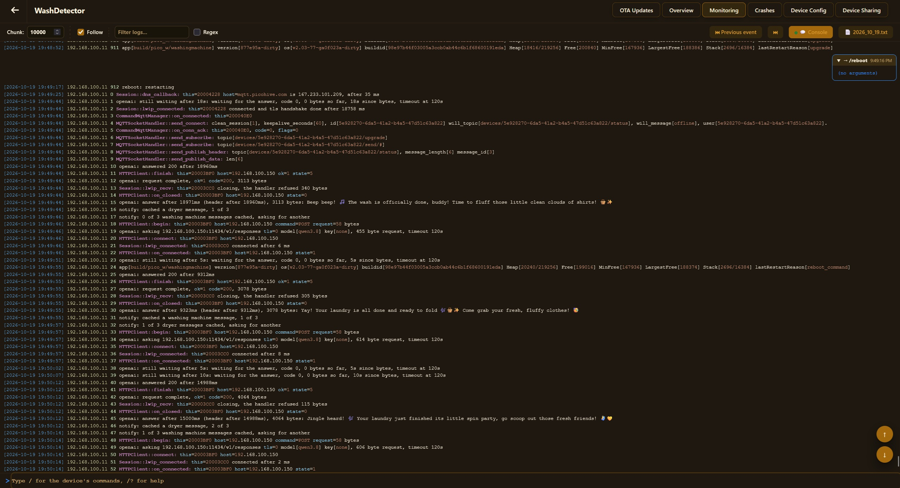
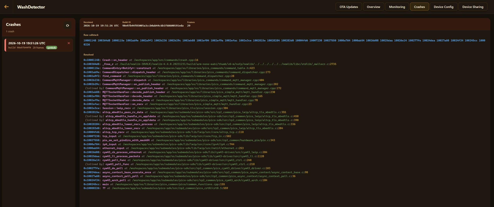
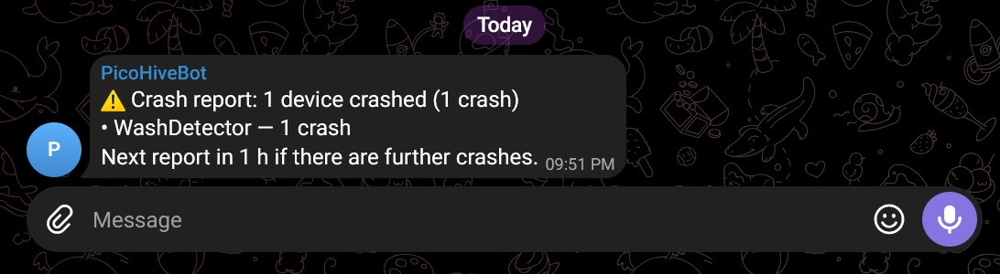

# Logs and crashes

[← Back](../README.md)

- It's hard to debug projects remotely with a serial console
- So we're going to send the logs and crashes back to us

# Web UI

This is what to expect on picohive.com





With notifications sent out over telegram when devices crash



# How code works

## Sending logs

```c
#include "pico_logger.h"

trace("valve %d open for %u s", id, seconds);
```

- This sent over UDP to the MQTT host address on the logging port from the config page (if set up)
- UDP is unreliable, potentially out of order or duplicated. That's an acceptable trade off
- Logging should never stall the board
- Each line has a counter, so gaps/duplicates/out-of-order are easy to spot
- printf isn't available, and the build fails if something links it in

## Receiving logs

```bash
python3 os/util/log_decrypt.py --port 23500
python3 os/util/log_decrypt.py --port 23500 --out-dir logs
```

`nc -ukl 23500` works too, as long as logs aren't encrypted

### Encrypted logs

- Put a log key on the config page (32 or 64 hex characters) and each line goes out as an AES-GCM packet
- log_decrypt.py generates a key with: --genkey
- receiver accepts key parameters via: --key or --keys
- The packet format is at the top of `libraries/pico_logger/log_encryption.h`

### When the network is the problem

- set-debug-log/<bytes> keeps a log in flash. The size is stored with the other settings, set to 0 to delete
- view-debug-log reads it back later
- do not use this if not needed - wears out flash, storage is limited
- will likely get removed in the future

## Crashes

- Board saves its call stack in RAM and reports it after restart
- That is via logging and via publishes to `devices/<id>/crash`
- You need the elf file to decode
- build id is constantly reported in logs to match the appropriate elf

Contents:
```
report_saved_crash: watchdog info: 1/0, last_command: 0xdeadbeef, cur_depth: 29
Print call stack: addr2line -e build/pico_w/hello_world.elf -afpiC 1000ebba 1000eae8 1000c4e2 ..
```

Use the command provided above to get call stack resolved:

```
0x10000618: RequestHandler::onWebSocketData(unsigned char*, unsigned int) at request_handler.cpp:81
0x1002c396: WebSocketHandler::decodeData(...) at websocket_handler.cpp:112
0x1002bd14: HTTPSession::on_recv(...) at http_session.cpp:81
```

## Restart reasons

Every boot logs a reason for the last restart:

| Reason | Meaning |
|---|---|
| `FAIL` | `panic()`, `fail()`, an lwIP assert, `exit()` |
| `FAULT` | hard fault |
| `WATCHDOG` | hang that led to soft watchdog timeout |
| `HW_WATCHDOG` | hang with IRQs off |
| `WIFI_INIT_FAILED`, `WIFI_CONNECT_FAILED`, `WIFI_LINK_LOST` | Wi-Fi failures |
| `APP_START_FAILED` | `on_wifi_ready()` returned false |
| `REBOOT_COMMAND`, `UPGRADE`, `SLEEP` | intentional |
| `UNKNOWN` | no clue, feel free to improve |

## Memory

Every 30 seconds the log has a line with the heap and stack:

```
app[build/pico2_w/my_app] version[v1.2-3-gabc1234-dirty] os[4f2e9a1] buildid[...] Heap[61234/198000] Free[136766] MinFree[120400] LargestFree[98304] Stack[8700/16384]
```


## Stack

```bash
python3 os/util/stack_depth.py build/pico2_w/my_app.elf
```

- This tries to get the longest call stacks based on build info using heuristics
- It's a good guess if we're likely to stack overflow or not

## lwIP and mbedtls debug

- Actual LWIP logs can be enabled by swapping lwipopts_debug_off.h for lwipopts_debug_full.h in os/config/lwipopts.h and build without NDEBUG
- lwipopts_debug_full.h also turns on LWIP_DEBUG_CHECKS: all of lwIP's stats counters and the guard bytes around each allocation
- do NOT enable UDP logs, UDP is used for logging already
- There's a LOT of output
