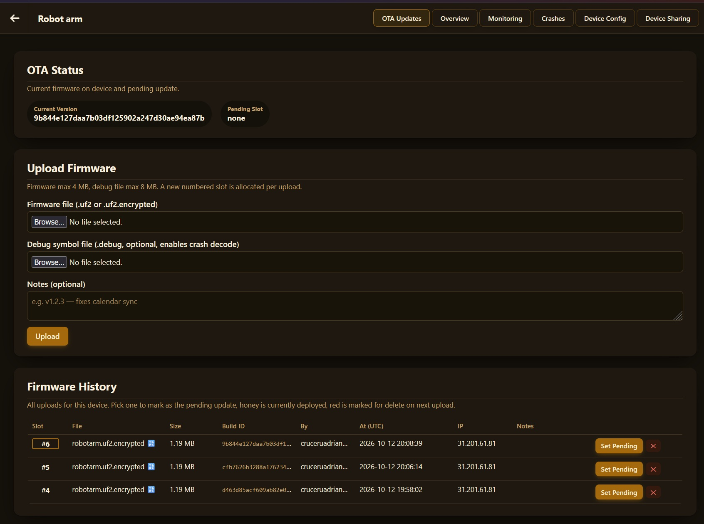

# OTA upgrades

[← Back](../README.md)

# Usage



Web UI takes care of managing files and pushing those towards devices
This allows for later processing of crash callstacks

# How code works

## Notes

- The file is written to a spare area of flash as it arrives
- Code checks that file is signed/encrypted and these are valid
- Code checks firmware target board is correct toavoid flashing pico2_w on pico_w
- Copy over the running firmware once everything is ok
- Signature is controlled by private key so keep that secure

## Limitations

- Encryption only protects the file on its way to the board
- The decryption key is inside the firmware, anyone who can read the flash can read the image
- Final copy over the running firmware isn't atomic (power goes out - reflash over USB)
- If bad firmware or power goes out - you need to reflash over USB
- No protection against rollback: any properly signed build installs

## Keys

- **Signing:** only whoever holds `ota_signing_key.pem` can make firmware a board
  accepts; the board carries just the public half.
- **Encryption:** the firmware is unreadable on the way, for when it crosses a
  network you do not trust. The key is built into the binary, so anyone with
  the board's flash can read it.
- Keys committed to a public repository protect nothing: anyone can sign for a
  board that trusts them. Fine for a demo, or a first version to move off with
  [Changing keys](#changing-keys).

- Keys live in keys/versions/<n>/ in your project, and the template creates version 0
- ota_signing_key.pem is the private key - back it up
- The other three files are compiled into the firmware or used to encrypt
- CMakeLists.txt controls which keys are used:

```cmake
set(PICO_OS_KEY_VERSION 0)       # what boards in the field have, upgrades are signed with this
set(PICO_OS_NEXT_KEY_VERSION 0)  # what this build carries, and will accept from now on
```

- Missing versions are generated when you build. Existing keys are never overwritten
- Use PICO_OS_KEY_DIR to have them somewhere other than keys/. (still need to be in repo to pass to docker build)

### Changing keys

- Keep PICO_OS_KEY_VERSION at 0
- Set PICO_OS_NEXT_KEY_VERSION to 1
- This will create a build signed with key 0 that will accept key 1
- Build and flash every board
- Set PICO_OS_KEY_VERSION to 1 for future builds
- Done, everything uses key 1 from now on

## Doing it by hand

```bash
os/signing/create_keys.sh 1
os/signing/encrypt_my_binary.py build/pico2_w/app.uf2 --keys keys/versions/0 --board pico2_w --elf build/pico2_w/app.elf
os/signing/verify_signed_binary.py build/pico2_w/app.uf2.encrypted --keys keys/versions/0
```

## File formats

Little endian throughout

```
.uf2.encrypted
[MAGIC "ENCRUF2\n", 8][HEADER_SIZE, u32][KEYLEN, u32][EPHEMERAL_KEY]
[TAG, 16][BUILD_ID, 20][BOARD, 16][SIGLEN, u32][SIG][CIPHERTEXT]
```

## Flash layout

- Flash is split into the running firmware's slot, a staging slot of the same size, and the filesystem
- It's all in `config/flash_layout.h`
- The firmware can be up to 824 KB on the Pico W and 1 MB on the Pico 2 W
- If a build gets bigger than that, the link fails with `firmware is larger than its flash slot`
- Changing the filesystem on boards already in the field can cause corruption, be ready to flash nuke them
